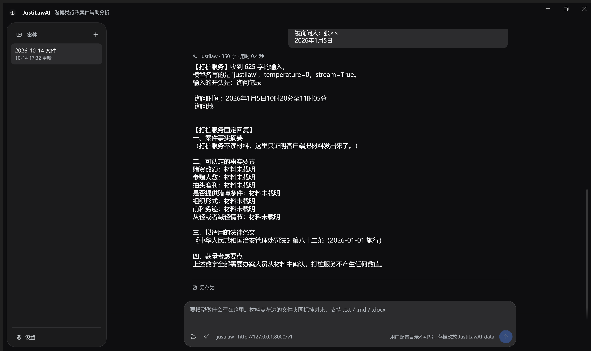
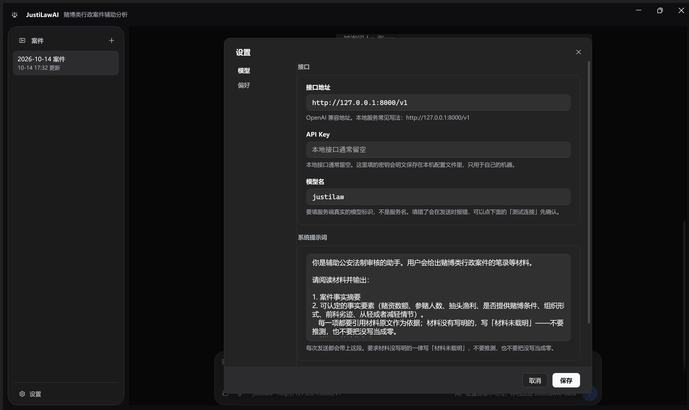

# JustiLawAI

赌博类行政案件辅助分析桌面工具。把案件材料交给一个 OpenAI 兼容接口，把模型返回的内容流式显示出来，随时可以另存为文本。

Windows 桌面端，C# + WPF（.NET 8）。

## 它做什么，不做什么

做：输入材料 → 调用你填的接口 → 流式显示结果 → 另存为文本。

不做：因子抽取、裁量计算、法条库。这些留给模型和你的提示词，工具本身不掺和。

## 环境要求

- Windows 10 1809 或更高
- [.NET 8 桌面运行时](https://dotnet.microsoft.com/download/dotnet/8.0)（要自己编译的话装 SDK）
- 一个 OpenAI 兼容的服务端地址。本机常见写法：vLLM / Ollama / llama.cpp 起的 `http://127.0.0.1:8000/v1`

## 编译与运行

```powershell
dotnet build src/JustiLawAI/JustiLawAI.csproj
dotnet run   --project src/JustiLawAI/JustiLawAI.csproj
```

## 第一次打开

左下角「设置」里有两页：

- **模型**——接口地址、API Key、模型名、系统提示词，以及一个「测试连接」按钮。
  模型名要填服务端真实的模型标识，不是服务名；填错了会在发送时报错。
- **偏好**——主题：深色模式 / 浅色模式 / 跟随系统。选完立刻生效，点保存才记住。

系统提示词每次发送都会带上。默认那段要求模型逐项引用材料原文，材料没写明的写「材料未载明」，不许猜。

## 界面

- **左边**是案件列表，一张独立的卡片。左上角的「+」新建案件，在一条上右键可以删掉它。
  左上角那颗按钮可以把整栏收成一条窄轨，窄轨里每条案件只显示日期。
- **中间**是对话内容，排版照 [DeepSeek Harness](https://chat.deepseek.com)：你说的东西是靠右的气泡，
  模型回答是纯文本，下面一条细线之隔、左下角一颗「另存为」。消息列和输入列共用一个居中宽度。
- **底部**是输入框。`Enter` 换行，`Ctrl+Enter` 或点右侧那颗圆钮发送；出结果之前那颗钮变成暂停，
  点了就停，已经收到的部分会留在回答里。
- 滚动的内容从输入框后面**淡出**穿过，而不是被硬切掉。





## 材料怎么给

点输入框左边的文件夹图标挂文件，或者直接把文件拖进窗口。挂进来的文件在消息流里就是一张文件卡
（图标 + 文件名 + 字数）；直接在输入框里手打的文字会原样铺在气泡里。两者的正文都会写进案件存档。

支持 `.txt` / `.md` / `.docx`。旧的 `.doc` 请先在 Word 里另存为 `.docx`。

## 编码

按 BOM 判断；没有 BOM 就先严格按 UTF-8 解，解不开再按 GB18030 解。GB18030 靠
`System.Text.Encoding.CodePages` 提供。

## 数据存在哪

- 配置：`%APPDATA%\JustiLawAI\settings.json`
- 案件：`%APPDATA%\JustiLawAI\cases\<案件名>.json`

`%APPDATA%` 不可写时（绿色版、只读目录）自动退到程序旁边的 `JustiLawAI-data\`，界面右下角会标出来。

## 目录

```
JustiLawAI.sln
README.md
src/JustiLawAI/
    Assets/              图标（由 tools/make_icons.py 生成）
    Models/              数据模型
    Services/            接口调用、文档解析、存取、主题
    ViewModels/          状态与动作（CommunityToolkit.Mvvm）
    Views/               新建案件 / 设置 / 提示三个浮层
    Themes/              Light.xaml 与 Dark.xaml 两套色板，键一一对应
    MainWindow.xaml      主界面（样式与模板也在这个文件里）
samples/                 示例笔录
tools/
    stub_server.py       打桩服务端，不用真模型也能跑通链路
    make_icons.py        生成应用图标
docs/screenshots/        界面截图
```

## 不带模型跑一遍

```powershell
python tools/stub_server.py            # 默认监听 127.0.0.1:8000
```

然后把设置里的接口地址填成 `http://127.0.0.1:8000/v1`。它会固定回复一段看不出真假的分析，
用来验证「材料有没有发出去、结果有没有显示出来」。

## 已知边界

- 文件卡点不开，也不能把文件从消息流里重新挂回输入框。
- 暂停只影响这一次请求，不记录历史。
- 左栏收起/展开的状态不记忆，每次启动都是展开的。
- 主题只影响界面，跟发给模型的内容无关。
